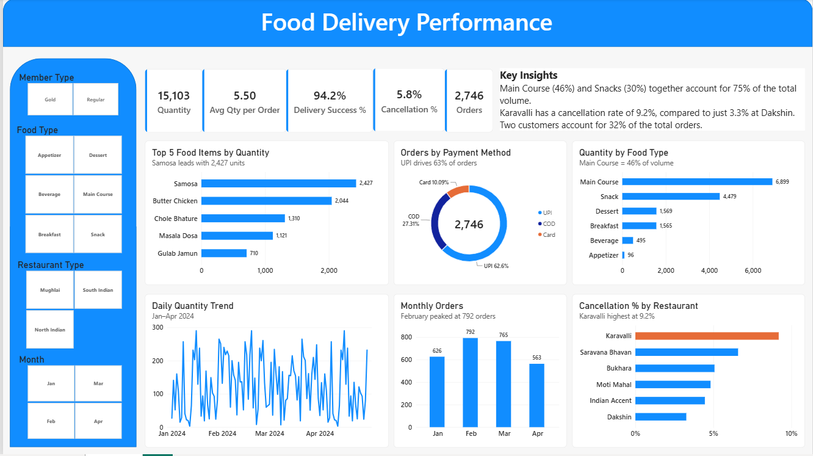
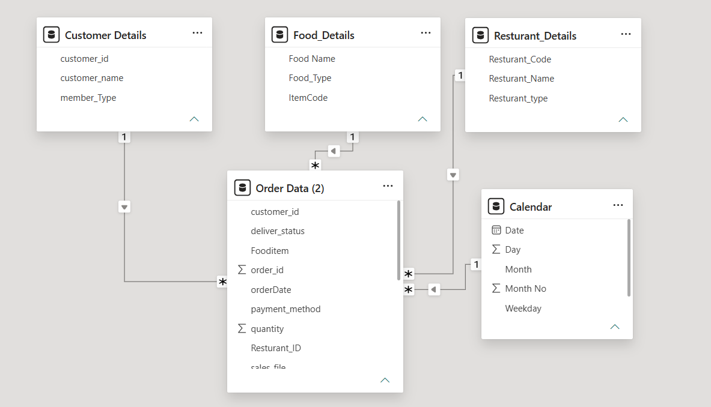

# Food Delivery Dashboard (Power BI + SQL)

I built this dashboard to understand how a food delivery business is doing across four months (Jan to Apr 2024). The data has 2,746 orders from 6 restaurants, 23 food items and 30 customers. I also answered the same questions in SQL to cross-check the results.



## What I wanted to find out

- How many orders and how much quantity did we handle?
- How many orders actually got delivered?
- Which food types and items sell the most?
- Which restaurant has the most cancellations?
- Is the business depending too much on a few customers?

## The data

I got one Excel file for each month (January to April) with the orders, and one more file with three small tables: customers, food items and restaurants.

The order files have the order id, date, customer, restaurant, food item, quantity, delivery status and payment method. There is **no price column**, so I could not calculate revenue. Everything here is based on orders and quantity.

## How I built it

**1. Combining the four months**
I loaded all four files in Power Query and appended them into one table. This took me a few tries. At first I only had April, so my dashboard showed 563 orders instead of 2,746. After I appended the other three months, the numbers matched (626 + 792 + 765 + 563).

I also kept the sheet name as a column called `sales_file`, so I can always tell which file a row came from.

**2. Checking the data**
The files were already in good shape. I checked for duplicate order ids and missing values and found none. The only fix I needed was in the customer table, where member type was written as "G" and "R" in some rows. I changed them to "Gold" and "Regular".

**3. Calendar table**
The order files only have a date column, so I made a separate Calendar table for 1 Jan to 30 Apr 2024. It has the month name, month number, day and weekday. I marked it as a date table and connected it to the order date.

```
Calendar =
ADDCOLUMNS(
    CALENDAR(DATE(2024,1,1), DATE(2024,4,30)),
    "Month No", MONTH([Date]),
    "Month", FORMAT([Date], "MMM"),
    "Day", DAY([Date]),
    "Weekday", FORMAT([Date], "dddd"),
    "Weekday No", WEEKDAY([Date], 2)
)
```

I sorted the Month column by Month No so the charts show Jan, Feb, Mar, Apr and not A to Z.

**4. Data model**
I used a star schema. The orders table sits in the middle and connects to Customers, Food, Restaurants and the Calendar table. All relationships are one to many.



**5. Measures (DAX)**

```
Total Orders       = DISTINCTCOUNT('Order Data (2)'[order_id])
Total Quantity     = SUM('Order Data (2)'[quantity])
Cancelled Orders   = CALCULATE([Total Orders], 'Order Data (2)'[deliver_status] = "Cancelled")
Cancel %           = DIVIDE([Cancelled Orders], [Total Orders])
Delivery Success % = 1 - [Cancel %]
Avg Qty per Order  = DIVIDE([Total Quantity], [Total Orders])
Prev Month Orders  = CALCULATE([Total Orders], DATEADD('Calendar'[Date], -1, MONTH))
Orders MoM %       = DIVIDE([Total Orders] - [Prev Month Orders], [Prev Month Orders])
Top 2 Customer Share =
VAR t = TOPN(2, VALUES('Customer Details'[customer_id]), [Total Orders])
RETURN DIVIDE(CALCULATE([Total Orders], t), [Total Orders])
```

I used DISTINCTCOUNT for orders because order id is just a label. My first version summed it and showed a meaningless number.

## SQL

I answered the same business questions in MySQL to cross-check the Power BI numbers.

- `sql/setup.sql` loads the data. The four monthly tables are combined with UNION ALL (like the append step in Power Query), the member type is cleaned with CASE, and the dates are converted from text to real dates.
- `sql/queries.sql` has 10 queries: joins, grouping, subqueries, a CTE and a window function (LAG, for month-over-month change).

The results match the dashboard (2,746 orders, 15,103 quantity, Karavalli at 9.2%). It needs MySQL 8 or newer.

## Problems I ran into

Most of my mistakes came from the same thing: I assumed Power BI had created the relationships between my tables, but it hadn't. It only detects them on its own in some cases (for example when the column names match). My columns had different names, like `Resturant_ID` in the orders table and `Resturant_Code` in the restaurant table, so I had to create the relationships myself in Model view. Now I always check Model view first.

- **Every restaurant showed the same cancel rate (5.8%).** The restaurant table was not connected to the orders table, so the restaurant filter did nothing. After I created the relationship, the real numbers showed up.
- **The Monthly Orders chart showed 2,746 for every month.** Same reason: my Calendar table was not connected to the orders table. Connecting the date columns fixed it.
- **Months were in the wrong order** (Apr, Feb, Jan, Mar). I sorted the Month column by Month No.
- **The model had extra tables.** After appending, the three monthly tables were still loaded into the model next to the combined table. I turned off loading for them so only the combined table is used.
- **In SQL, my first date conversion failed.** The dates were text like 1/22/2024 and I assumed day/month/year. MySQL gave an error on 1/13/2024, which showed me it was month/day/year.

## What I found

- **Total:** 2,746 orders and 15,103 items. About 94.2% of orders were delivered and 5.8% were cancelled.
- **Main Course and Snack make up about 75% of everything sold.** Samosa, Butter Chicken and Chole Bhature are the top three items.
- **Karavalli has the highest cancellation rate at 9.2%** (34 out of 370 orders). Dakshin has the lowest at 3.3%.
- **UPI is the most used payment method** (62.6%), then COD (27.3%) and card (10.1%).
- **February was the busiest month with 792 orders.** April dropped to 563, which is about 26% lower than March.
- **Two customers placed 32% of all orders** (890 out of 2,746). Everyone else placed between 48 and 82 orders. This looked odd to me, so I would want to check if these are bulk or business accounts.
- Gold members place about 61% of the orders.

## What I would look at next

- Why Karavalli has so many cancellations (kitchen, delivery, or items running out).
- Whether the two big customers are real individual customers.
- Why April dropped. The data does not explain it and four months is not enough to say if it is a trend.

## Limits of this project

- No price data, so no revenue or average order value.
- Only four months of data.
- Some restaurants have few cancellations (8 to 48), so the comparison between them is rough.

## Files

- `Food_Delivery_Dashboard.pbix` is the Power BI file
- `images/` has the dashboard and data model screenshots
- `sql/setup.sql` loads and cleans the data in MySQL
- `sql/queries.sql` has the SQL queries

## Update log

- First version: dashboard, data model and DAX measures.
- Added SQL (setup and 10 queries).

Built with Power BI, Power Query, DAX and MySQL.
